# Plain story 2: ACh flashes, how large they are and where they recur

## Observation 1

Opening the `*_ALS.tif` files in ImageJ:

- **Multiple flashes** appear in **multiple frames**.
- At **60X**, a flash often covers **most of the field of view** (1024 × 1024 px).

> Note: flashes are recognized frame by frame with a threshold of background peak + 2σ (global histogram of the ALS file). The mask is then cleaned (3 × 3 opening and closing, holes filled) and blobs smaller than **5,000 px** are removed. The limit is in pixels, so in µm² it depends on the objective: 60X 247 µm², 40X 556 µm², 10X 8,889 µm².

**Fig. 1 — Area of 60X flashes.** GACh3.0, 5,773 flashes from 55 recordings (13 slices). Blue = inside the frame (3,091, 54 %), orange = touching the frame edge (2,682, 46 %). Dashed line = frame size (51,782 µm²). The large flashes all touch the frame edge.

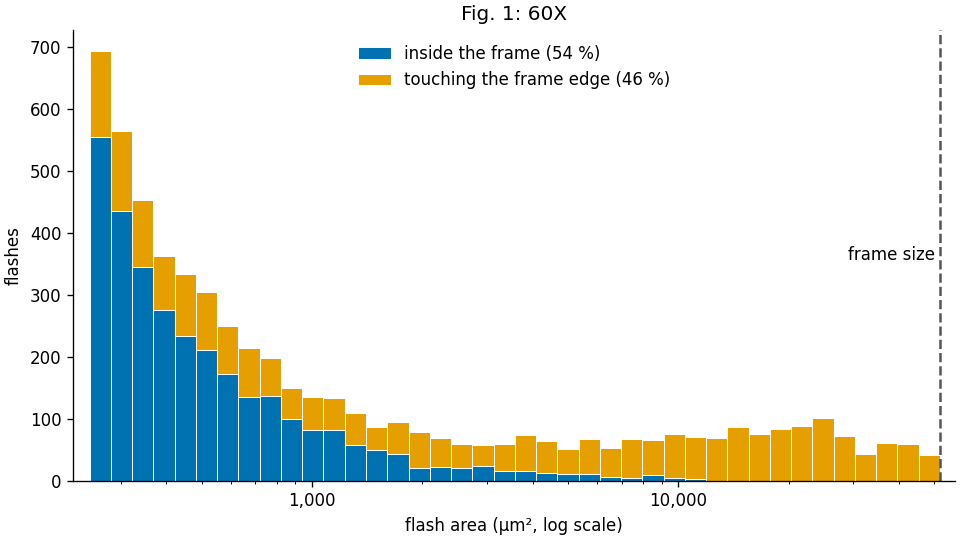

The 40X recordings can be checked the same way.

**Fig. 2 — Area of 40X flashes.** Same as Fig. 1. GACh3.0, 2,308 flashes from 14 recordings (2 slices). Inside the frame 1,103 (48 %), touching the frame edge 1,205 (52 %). Dashed line = frame size (116,508 µm²).

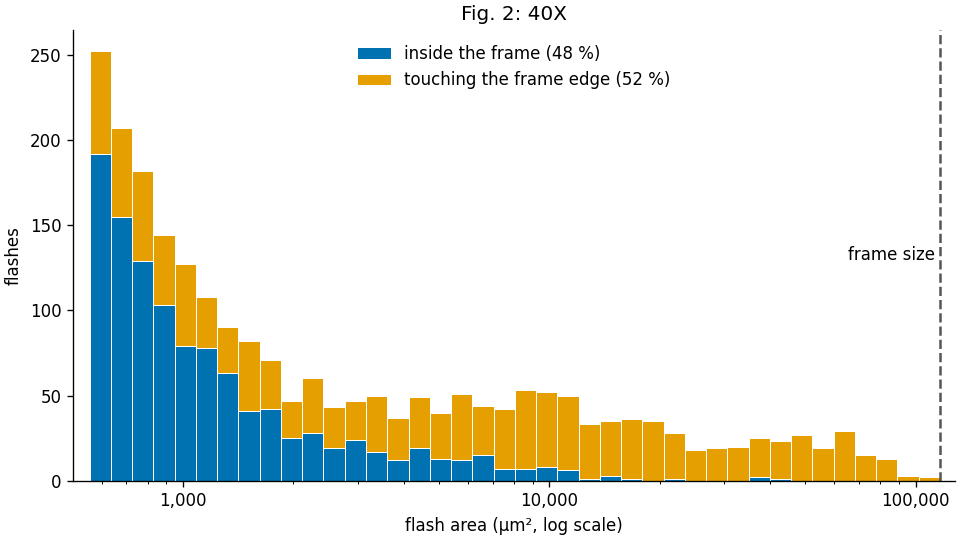

Recordings, slices and animals of Figs. 1–2: `tables/flash_area_recordings.xlsx` (sheets `summary`, `60X`, `40X`).

---

## Summary 1

- At 40X and 60X, many flashes are cut by the edge of the field, so their full size can't be measured.
- **→ 10X is the right objective** to see the whole area of a flash.

---

## Question 1

**❓ What is the overall area of the flashes, and how does it compare with the axon arbor of one cholinergic interneuron (ChI)?**

- Yardstick: the area covered by one ChI's axon arbor, measured on the reconstructed rat ChI of Aosaki & Kawaguchi 1996, Fig. 1Ab (slice, biocytin): extent 395 × 263 µm.

**Fig. 3 — Area of 10X flashes vs one ChI's axon arbor.** A: the reconstructed axon (Aosaki & Kawaguchi 1996, Fig. 1Ab) with its convex hull (orange, 78 × 10³ µm²) and bounding box (gray dashed, 104 × 10³ µm²). B: area of every flash, GACh3.0, 10X: 17,567 flashes in 74 recordings (of 103; 29 had none), median 31 × 10³ µm². Below the hull: 80.0 % (reaching: 20.0 %, 3,511 flashes); below the box: 87.2 % (reaching: 12.8 %, 2,246). Flashes = the per-frame flashes of `results/spontaneous/mask/` with blobs < 5,000 px removed (pipeline step 2a: close blobs merged, > 80 % of the frame dropped).

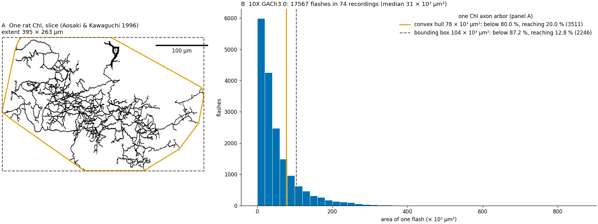

**12.8–20.0 % of flashes can potentially cover the whole field of an axon arborization.**

From this, the flashes **may be produced by single ChIs**.

**Fig. 4 — Flashes touching the frame edge, by objective.** Share of all flashes that touch the frame edge, GACh3.0: 60X 46.5 % (5,773 flashes), 40X 52.2 % (2,308), 10X 39.2 % (19,587). Same flash definition for all three objectives: one connected blob in one frame (the 10X blobs are not merged, so their count differs from Fig. 3).

> Note: the sample sizes are very different: 60X comes from 13 slices, 40X from only 2. The 40X recordings were a quick test to see whether the whole field of a flash could be captured, but the field of view was still too small.

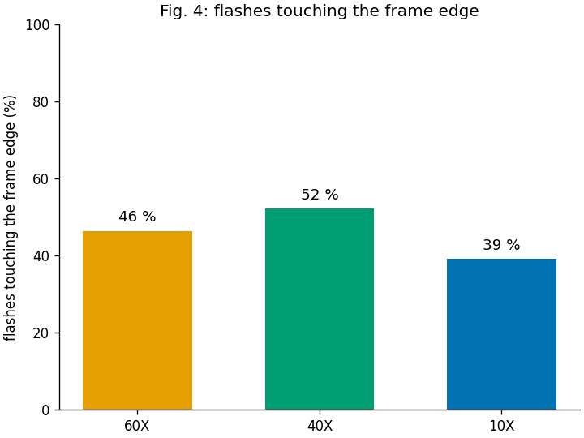

At 10X, 7.3–13.0 percentage points fewer flashes touch the frame edge than at 60X / 40X.

---

## Observation 2

- Flashes seem to **recur at some areas** of the striatum.
- Some flashes appear in **consecutive frames** at the same place.

---

## Question 2

**❓ Can the flashes be grouped by their spatial and temporal relations?**

- If a flash is produced by a certain ChI, the flashes of that ChI should form a group.
- If such groups really exist, it **strengthens the idea** that the flashes are produced by single ChIs, i.e. that they are ACh release events.

---

## Idea for Question 2: grouping

### A trace tells where an ROI is

1. An ROI gives a **temporal trace** (mean intensity inside the ROI, in every frame).
2. Two ROIs at the **same location** give identical traces → Pearson's correlation at 0 lag (r) = **1**.
3. So flashes at **close** locations should have r close to 1.

**Fig. 5 — Correlation between flash traces.** `2026_01_08-0012`. Each flash's footprint is used as an ROI; trace = mean ALS value inside it, every frame. A (frame 17) and B (frame 283, another event) are in recur_zone 2; B is the flash of zone 2 whose trace matches A best. C (frame 1083) is the largest flash of recur_zone 13, which shares no pixel with zone 2. r with A: A = 1, **B = 0.992**, **C = 0.139**. Left: footprints on the max projection. Right: the three traces; dotted line = the flash's own frame.

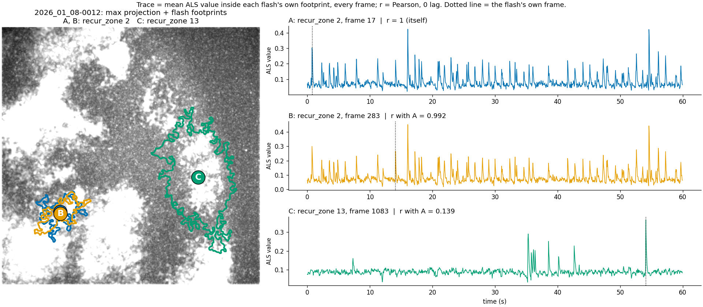

### Grouping steps (`spontaneous_analysis.py`, `classes/sp_zone_analyzer.py`)

1. **Detect flashes.** Threshold = background peak + 2σ of the ALS histogram. Mask cleanup drops blobs smaller than 5,000 px (4,000 px in the current `results/`). Blobs larger than 80 % of the frame are dropped (over-exposed first frames).
2. **Consecutive frames → units.** A flash in frame n+1 joins a flash in frame n if its centroid lies inside n's circle (centroid → farthest pixel). A unit is one flash, or a chain of flashes over consecutive frames.
3. **Traces.** Every flash's footprint is used as an ROI → one trace per flash.
4. **Trace correlation → groups.** r between two units = the **best r** among all pairs of their flashes' traces. A group = units in which **every two** have r ≥ 0.95.
5. **First recur_zones.** Each group is a recur_zone. Its flashes recur at the same place and share the same time course.
6. **Merge.** Some recur_zones are very close but stay separate, because their r is a little lower (e.g. 0.94 or 0.91). A recur_zone ≥ 95 % inside another is merged into it.
7. **Fit leftovers.** A unit that joined no group (a leftover) joins its best recur_zone if its best flash lies ≥ 90 % inside it.
8. **NR zones.** Leftovers that still overlap each other form **NR zones** (non-recurring zones). Single leftovers are dropped.
9. **Only steps 4–7 make recur_zones.** NR zones are shown on the maps for reference, but left out of every statistic.
10. **Events and rate.** An event = a run of consecutive active frames of a recur_zone. Event rate per recur_zone = 1 ÷ mean interval between event starts.

**Fig. 6 — All recur_zones of one recording.** `2025_06_11-0003` (11 recur_zones + 2 NR zones). Left: zone map page 1, max projection with every recur_zone filled. Right: all outlines on white (Jeff's suggestion, planned as page 2 of `{stem}_ZONE_MAPS.tif`). NR zones gray dashed; dashed = striatum boundary.

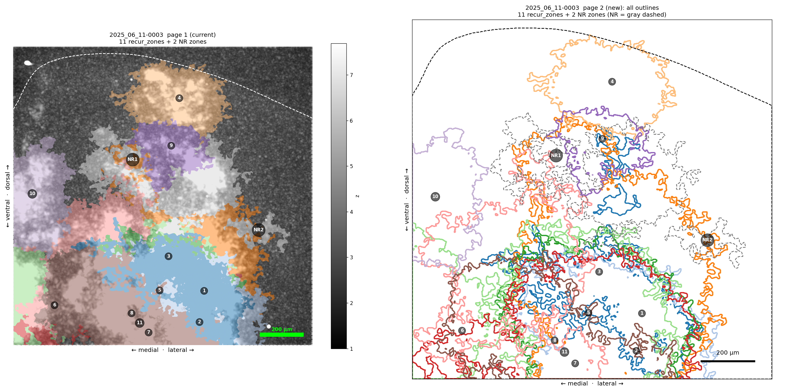

**Fig. 7 — Each recur_zone and the zones it overlaps.** `2025_06_11-0003` (11 recur_zones + 2 NR zones). One panel per recur_zone: its outline plus every zone sharing ≥ 1 px with it; identical sets shown once. Colors as on the zone map; NR zones gray dashed; black dashed = striatum boundary.

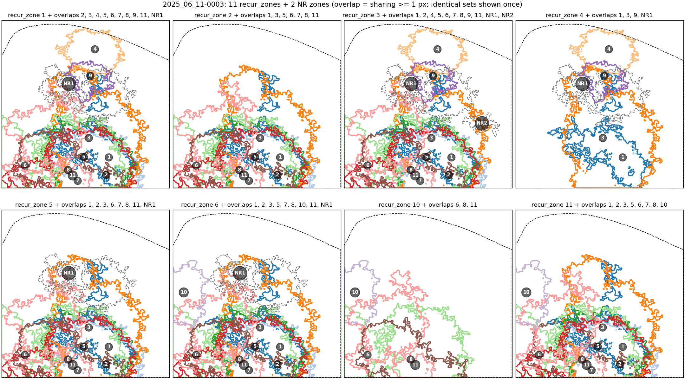

Some recur_zone contours are still close to each other and highly overlapped.

### Montage of grouped zones

To make the maps readable, zones that share a centre are shown together, one panel per group (`scripts/zone_groups.py`). NR zones are ignored for the grouping.

1. **Centroid** of every recur_zone = centre of mass of its mask.
2. **Circle** of every recur_zone, centred on its centroid. Two versions:
   - **inner circle:** radius = distance to the zone's nearest edge (largest circle at the centroid inside the zone);
   - **furthest circle:** radius = distance to the zone's farthest pixel (circle enclosing the whole zone).
3. **Sort** the zones by area.
4. **Group:** take the smallest remaining zone; every remaining zone whose centroid lies inside its circle joins its group. Draw the group's outlines with the largest at the bottom. Remove the group and repeat until all zones are used.
5. **Last two panels:** the largest zone of every group together, without and with NR zones.

**Fig. 8 — Grouped zones, inner circle.** `2025_06_11-0003`: 8 recur_zones → 5 groups; zones 1, 5, 4 and 3 share a centre. Dotted circle = the smallest zone's circle.

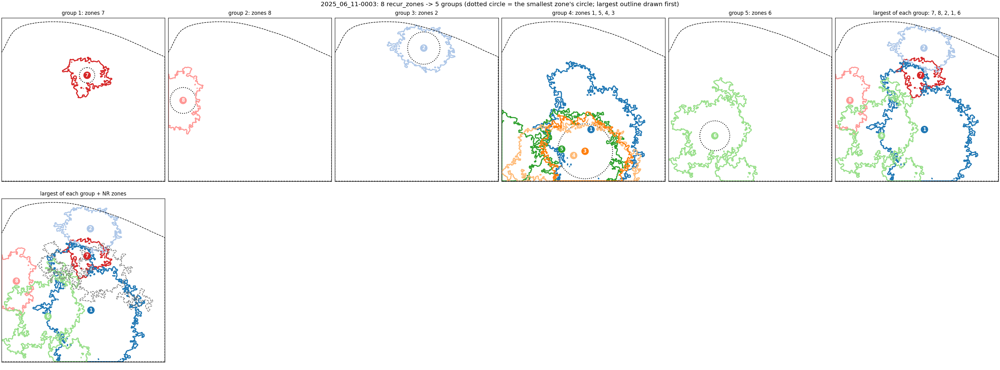

**Fig. 9 — Grouped zones, furthest circle.** Same recording: 8 recur_zones → 4 groups; zones 1, 5, 4, 6 and 3 in one group.

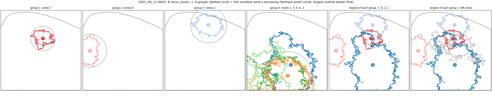

Other examples: `2025_06_11-0008` (8 zones → 7 groups inner / 6 furthest), `2026_01_08-0012` (14 → 12 / 9), same folder.

> Note: Figs. 8–9 already use the new mask cleanup (blobs < 5,000 px removed), so `2025_06_11-0003` has 8 recur_zones here instead of 11 (Figs. 6–7, current `results/`).

---

## Discussion

1. All the contours / outlines together look messy because some zones are still very close and of similar area. One way is to regroup them and show the groups in montages (Figs. 8–9). → Ask Jeff what he thinks.
2. (To be added)

> Note: status of the open items
> 1. ~~The overlap areas between all contours (the new sorted / grouped zones) have not been dealt with.~~ Done (measured only): in the pipeline, the overlap of every pair of group-largest zones (NR excluded) is saved as sheets `overlap_tight` / `overlap_loose` of `{stem}_ZONES.xlsx` (shared area, % of each zone). The contour montages (`zone_contours/{stem}_ZONE_CONTOURS_TIGHT/LOOSE.png`) now start with an "all zones" panel.
> 2. Spontaneous flashes on concatenated recordings of the same slice: tested on 3 slices (below), not in the pipeline yet.
> 3. To do: make the joined analysis an independent pipeline: script at the repo root, SLURM job on Saion, export to `results/contours/` with subfolders (e.g. `joined/`, `comparison/`).

### Test: separated vs joined recordings of one slice

Idea test only, not in the pipeline (`scripts/slice_concat.py`, removed 2026-10-18; restore from git history).

1. Recordings with the same date + SLICE + site (AT) are used together.
2. **Separated:** every recording is analyzed on its own, as in the pipeline.
3. **Joined:** masks, flashes and units stay per recording; from the trace correlation on, the flashes of all recordings are pooled. Each flash's trace runs over all recordings back to back (z-scored per recording), then grouping, merge, fit and NR zones run once.
4. Figures: largest zone of each group (LOOSE = furthest circle), no NR zones. Left = joined, right = separated recordings.

| Slice / site | Recordings | Separated: recur_zones per recording | Joined: recur_zones → largest (LOOSE) |
|---|---|---|---|
| 2025_06_11 4R / CELL_1 | 10 | 6–15 | 23 → 6 |
| 2025_12_15 4R / CELL_2 | 8 | 5–13 | 20 → 5 |
| 2026_01_08 2R / CELL_1 | 10 | 8–16 | 35 → 11 |

**Fig. 10 — Separated vs joined, 2025_06_11 4R / CELL_1 (LOOSE).**

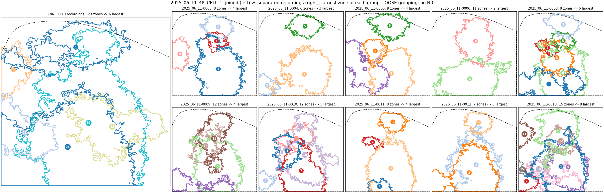

**Fig. 11 — Separated vs joined, 2025_12_15 4R / CELL_2 (LOOSE).**

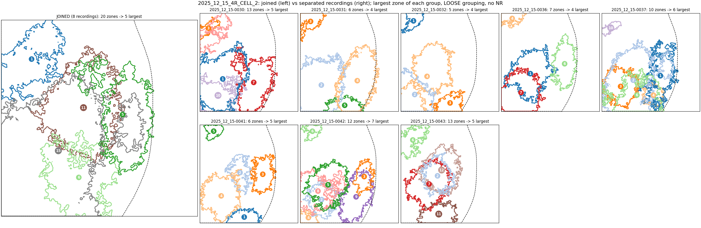

**Fig. 12 — Separated vs joined, 2026_01_08 2R / CELL_1 (LOOSE).**

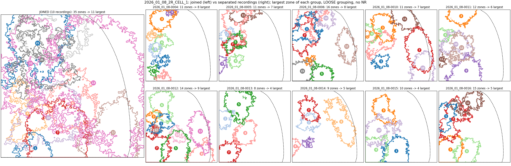

TIGHT versions (inner circle): same folder, `*_SEPARATED_VS_JOINED_TIGHT.png`.

---

## Follow-up: are the flashes random? (permutation test, temporary notes)

**❓ Could the flashes be random noise that happens to cross the threshold together, and do they recur at the same place more often than by chance?**

Test on 3 recordings only (2025_02_05-0006 and -0007: 60X, same slice; 2025_06_11-0009: 10X), **without** the 5,000 px limit.

### Flow

**Test 1 — is a blob bigger than chance?**

1. Cut every frame into tiles of 16 × 16 px.
2. Give each tile one random lag (0 … last frame); all pixels of a tile share it.
3. Slide each tile's movie in time by its lag (wraps around). Every tile keeps its own values, noise and flashes; only the **timing between tiles** becomes random.
4. Detect blobs in this surrogate stack with the same threshold and mask cleanup as the real data; keep the largest blob.
5. Repeat 100 times → **cutoff** = 95th percentile of the largest blobs. A real blob above the cutoff is not chance (p = 1 / 101 ≈ 0.0099).

**Fig. 13 — How Test 1 works (toy stack: 8 frames, 8 × 8 px, 4 tiles).**

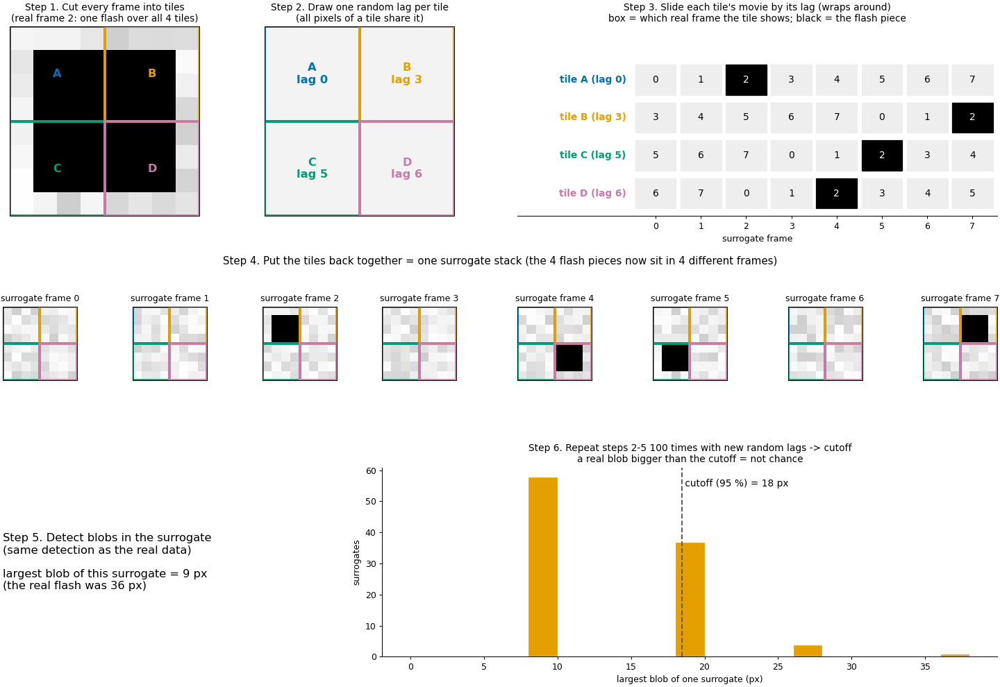

**Test 2 — do flashes recur at the same place?**

1. Keep only the real blobs above the Test 1 cutoff.
2. Map = for every pixel, the number of frames it is inside such a flash.
3. Shuffle: move every flash to a random position inside the frame (shape kept), 100 times.
4. Patches of the map (≥ k frames) whose sum is larger than in 95 % of the shuffled maps = **hotspots**.

> Note: shifting single pixels instead of tiles does not work on the ALS files. The Gaussian blur (sigma = 4 px) links neighbouring pixels, and a per-pixel shift breaks that link, so almost no noise blob survives (0006: 72 blobs instead of 774,203, largest 9 px). A cleaner version would shift single pixels **after the detrend and before the blur**, then run blur → ALS → detection on each surrogate (no tile size needed).

### Results

| Recording | Cutoff | Blobs above cutoff | Blobs ≥ 5,000 px | Hotspots |
|---|---|---|---|---|
| 2025_02_05-0006 (60X) | 2,345 px | 113 of 774,203 | 5 | 1 (p ≈ 0.0099) |
| 2025_02_05-0007 (60X) | 2,789 px | 41 of 800,683 | 2 | 1 (p ≈ 0.0099) |
| 2025_06_11-0009 (10X) | 2,623 px | 636 of 540,713 | 487 | 1 (p ≈ 0.0099) |

- Noise alone never made a blob bigger than ~2,300–2,800 px. **All flashes ≥ 5,000 px (Figs. 1–4) are above chance.**
- The tiny blobs (> 99.9 %) can't be told apart from noise.
- The cutoff could replace the fixed 5,000 px limit as a data-driven removal size.
- Each recording has one hotspot. In 0006 and 0007 (same slice) the two hotspots overlap: 63 % / 59 % of each lies inside the other.

**Fig. 14 — Test 1, 2025_02_05-0006.** Blue = real blobs, orange = largest blob of each surrogate, dashed = cutoff.

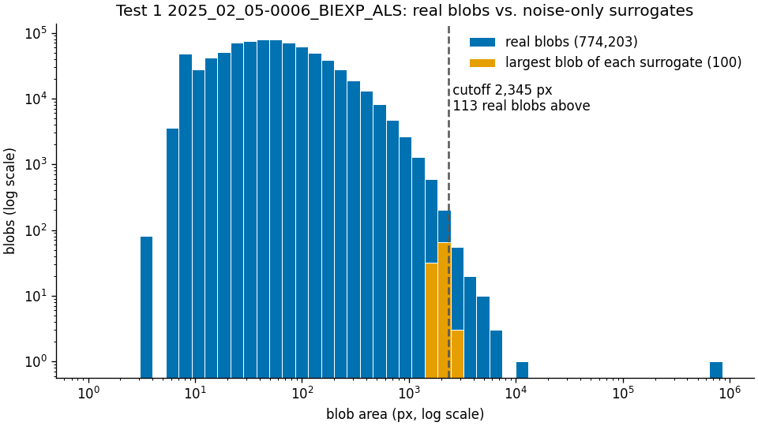

**Fig. 15 — Hotspots of 2025_02_05-0006 (blue) and -0007 (orange), same slice.** Grey = frames inside a flash (both recordings summed).

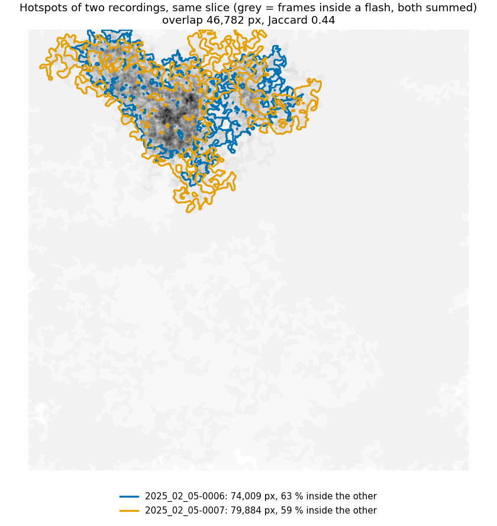

**Fig. 16 — Test 2, 2025_06_11-0009 (10X).** Left = real map with the hotspot (orange), right = one shuffle.

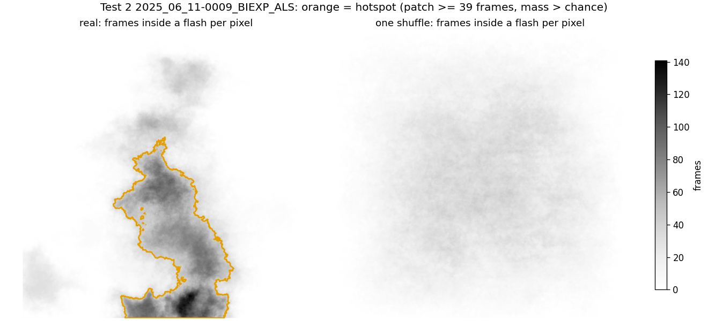

> Open: only 3 recordings so far; the tile size (16 px) is a choice, not tested; at 10X a hotspot may also follow brighter tissue. Scripts are still scratch: `output/test_permutation/permutation_test.py`, `toy_process.py`, `overlay_hotspots.py`.

> Next (if Jeff thinks this is a good approach): add the permutation step to `img_proc.py` (pixelwise shift after the detrend, before the blur), then rerun all recordings on the cluster (Saion).

---

## Follow-up: the small peak left of the main peak (global histogram)

**❓ The global histogram of every `*_ALS.tif` has a small peak on the left side of the main peak. What is it?**

- It sits at **exactly 0** in all 176 recordings (60X / 40X / 10X): counts pile up just below 0 and drop by ~20 % just above (median 20.3 %, range 15.1–23.0 %).
- Check: the same histogram of the file **before ALS** (`*_GAUSS.tif`) has no peak at 0 (drop 0.7–4.8 % = the normal slope of the curve), the ALS file has it (17.5–21.2 %).
- **→ The small peak is made by ALS**, not by the tissue. ALS (`p = 0.05`) pulls the baseline strongly onto points below it and weakly onto points above it, so the lowest points end up just below 0 after the subtraction. The same rule puts the background (main peak) slightly above 0 (~0.07).

**Fig. 17 — Global histogram before (GAUSS, left) and after ALS (right).** One recording per objective, 512 bins, linear y; red dotted line = 0.

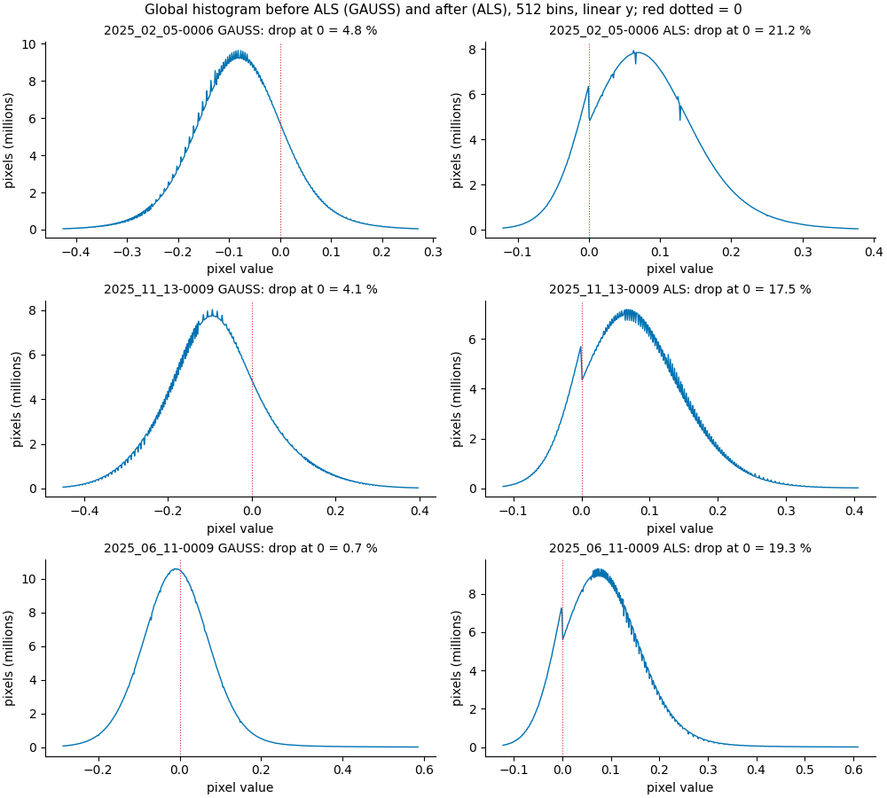

> Open: the peak lies on the left side of the main peak, which the background fit (threshold) uses; how much it moves the threshold is not tested. Scripts: `output/test_histograms/gauss_vs_als.py`, `hist_montage.py`, `zero_step.py`.

---

## Follow-up: describing the flash sizes with an exponential distribution (dirty try)

**❓ Can a few numbers of an exponential distribution describe how large the 10X flashes are?**

Data: every 10X flash ≥ 5,000 px of `output/flash_area/` (no 10X merge, one 4-connected blob per frame), GACh3.0, 103 recordings → **19,587 flashes**.

### The model and its parameters

The flash areas are put into a histogram with equal bins. An exponential decay says: the height of the bars drops by the **same factor** for every equal step in area. On a log-y axis this is a **straight falling line**.

> count of a bar = C · e^(−λ · (x − A₀)),  x = center of the bar, x ≥ A₀

| Parameter | Unit | Meaning | How it is obtained |
|---|---|---|---|
| **A₀** | µm² | Start of the fit: smaller blobs are not described. | Chosen: 5,000 px = 5,000 / 0.75² = **8,889 µm²** (10X: 0.75 px per µm). |
| **Bin width** | µm² | Width of every bar. | Chosen: **10,000 µm²**. |
| **C** | flashes per bar | Height of the line at A₀ (where the line starts). | Fitted (intercept of the line). |
| **λ** (lambda, "rate") | per µm² | **How fast** the bars drop as the area grows. Large λ = large flashes are rare (steep line); small λ = large flashes are common (flat line). | Fitted (slope of the line = −λ). |
| **1 / λ** ("scale") | µm² | The area step that lowers the bars by a factor e (2.72). In a pure exponential it is also the **average amount** by which a flash is larger than A₀. Same unit as the area, so it is the easiest one to read. | 1 / λ |
| **ln 2 / λ** ("half-area") | µm² | Area step that **halves** the bars. | 0.693 × (1 / λ) |
| **A₀ + 1 / λ** | µm² | **Mean flash area** of the fitted line (not of the data). | |
| **A₀ + ln 2 / λ** | µm² | **Median flash area** of the fitted line: half of the flashes smaller, half larger. | |

> Note: an exponential has **no memory**. A flash that already reached 30,000 µm² has the same chance to grow another half-area (and halve its count) as a flash that just reached A₀. If the real data follow the line, flash size behaves like "stop growing with a constant chance per µm²".

### How the numbers are calculated (10X, all recordings pooled)

1. **Histogram:** the 19,587 flashes in bars of 10,000 µm² starting at A₀. Example: the first bar (8,889–18,889 µm²) holds **7,747** flashes.
2. **Bars used:** from A₀ up to the **first empty bar** → **43 bars** (8,889–438,889 µm²). The bars further out (scattered single flashes up to ~1.8 million µm²) are left out: they would pull the line flat.
3. **Log of each bar:** e.g. 7,747 → ln = 8.955; the bar 208,889–218,889 µm² holds 68 → 4.220; the bar 428,889–438,889 µm² holds 3 → 1.099.
4. **Straight line** through the 43 points (least squares), x = bar center − A₀: slope = −λ = **−1.68 × 10⁻⁵ per µm²**, intercept = ln C = 7.674 → **C = 2,152** flashes per bar.
5. **1 / λ** = 1 / (1.677 × 10⁻⁵) = **59,624 µm²**; **half-area** = 0.693 × 59,624 = **41,328 µm²**.
6. **Mean** (line) = 8,889 + 59,624 = **68,513 µm²**; **median** (line) = 8,889 + 41,328 = **50,217 µm²**.
7. **Prediction for one bar**, e.g. 208,889–218,889 µm² (center 213,889, x − A₀ = 205,000): 2,152 × e^(−1.68 × 10⁻⁵ × 205,000) = 2,152 × e^(−3.44) = **69** (real: 68).

| Flashes from … (bar edge) | Real | Line | Real / line |
|---|---|---|---|
| 18,889 µm² | 11,840 | 10,835 | 1.09 |
| 28,889 µm² | 8,978 | 9,162 | 0.98 |
| 58,889 µm² | 4,773 | 5,540 | 0.86 |
| 108,889 µm² | 1,995 | 2,395 | 0.83 |
| 208,889 µm² | 452 | 448 | 1.01 |
| 308,889 µm² | 79 | 84 | 0.94 |

**Fig. 18 — Histogram of the 10X flash areas with the fitted exponential.** Equal bins of 10,000 µm², log y; red = the fitted line over the 43 continuous bars. Grey = the 67,809,511 blobs < 5,000 px (one bar 0–8,889 µm², not fitted); blue = the 19,587 flashes ≥ 5,000 px.

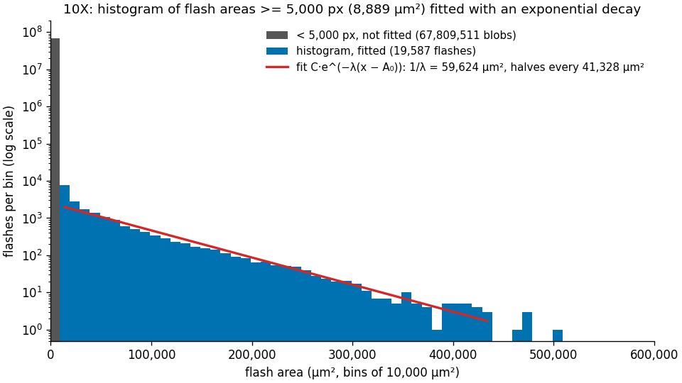

- From ~20,000 to ~440,000 µm² the bars follow **one exponential** (real / line 0.83–1.09): the size of the 10X flashes can be described by **1 / λ ≈ 60,000 µm²** (halves every ~41,000 µm²).
- Only the **first bar** (8,889–18,889 µm²) is clearly above the line (7,747 vs 1,979 on the line at its center): there are more flashes just above 5,000 px than the exponential predicts.

### Per recording

Same fit for each 10X recording: **63 of 103** recordings (needs ≥ 10 flashes and ≥ 3 continuous bars; the others have few flashes ≥ 5,000 px, many have none). Half-area per recording: median **29,548 µm²** (IQR 24,840–39,672).

- The per-recording half-areas are smaller than the pooled one (41,328 µm²): a single recording has fewer flashes, so its first empty bar comes earlier and its line covers mostly the steeper start.

**Fig. 19 — Per recording, page 1 of 6.** Grey = blobs < 5,000 px (dark bar at 0 + count, not fitted). All pages: `output/test_area_fit/per_recording/`; table: `output/test_area_fit/area_exp_per_recording_10X.csv`.

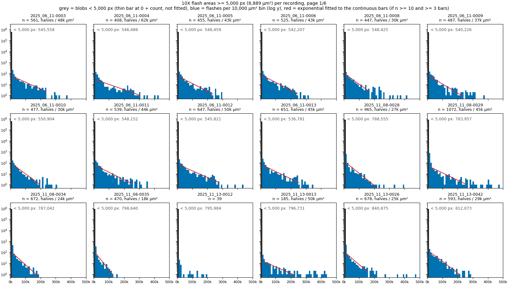

> Open: A₀ (5,000 px) and the bin width (10,000 µm²) are choices and change λ; "up to the first empty bar" is a rule of thumb; bars with 1–5 flashes have noisy logs. Scripts: `output/test_area_fit/area_exp_example.py`, `area_exp_per_recording.py`.

---

*(To be continued.)*
